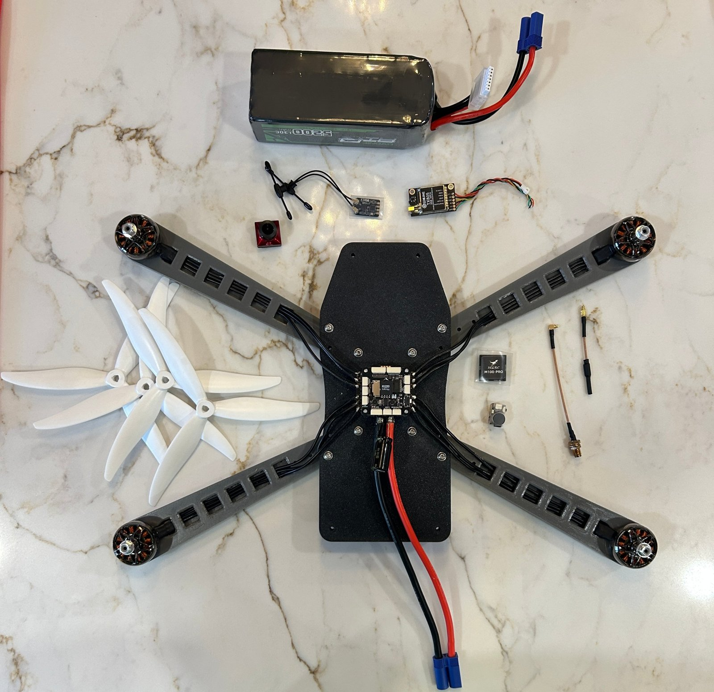
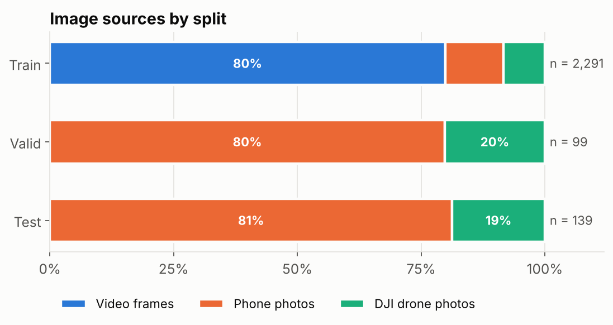
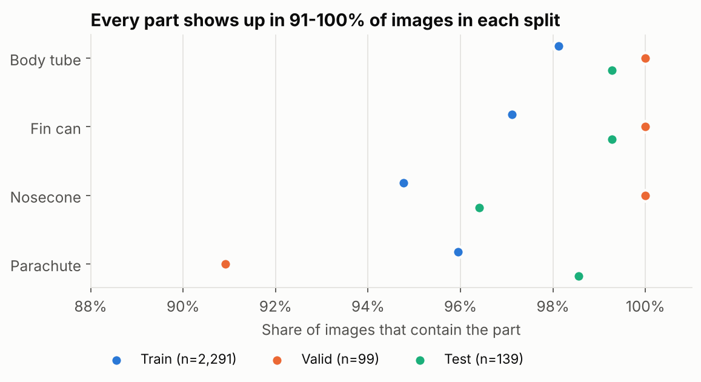
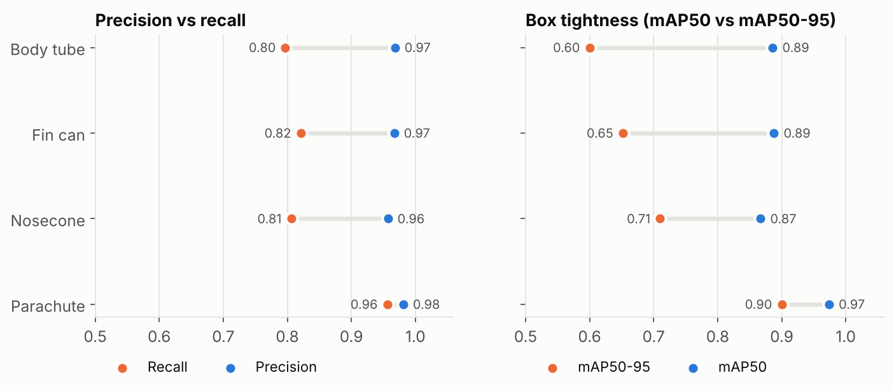

# Autonomous Drone: Rocket Recovery

A quadcopter that finds a landed, separated model rocket from the air and picks up the body tube with a claw. A YOLO26n model running on a Raspberry Pi 5 with an AI HAT+ spots the rocket's parts, and an ArduPilot flight controller flies the drone.



## Status

| Part | Status |
|---|---|
| Airframe and 3D design | Designed ([`cad/`](cad/)) |
| Rocket-part detection model | Trained: **0.90 mAP50** on held-out test photos |
| Running the model on the AI HAT+ (Hailo-8) | In progress |
| Claw and autonomous pickup | In progress |

## How it works

1. An Arducam IMX219 wide-angle camera looks down from about 6 ft.
2. The Raspberry Pi 5 runs the detection model on the AI HAT+ and finds four parts: **nosecone, body tube, fin can, parachute**.
3. The Pi guides the ArduPilot flight controller to center over the body tube, and the claw latches onto it. *(in progress)*

## Hardware

The full assembly is in [`cad/Total_Drone_Assembly_FinalVersion.f3z`](cad/) (Autodesk Fusion). Custom parts: center chassis plate, upper frame plate, arms, legs, frame spacers, and mounts for the camera, claw, GPS and receiver.

Bill of materials (about $800 total): [`hardware/BOM.md`](hardware/BOM.md).

## Detection model

**Dataset:** 2,529 photos and video frames of disassembled model rockets lying on grass, taken from handheld cameras and a DJI drone, covering two rocket designs. It's public on Roboflow: [Real_Drone_Data](https://universe.roboflow.com/anant-grover/real_drone_data).

| Split | Images | Notes |
|---|---|---|
| Train | 2,291 (6,816 after augmentation) | Flips, ±20% brightness and slight blur, 3× per image |
| Valid | 99 | Whole photo sessions held out |
| Test | 139 | Whole photo sessions held out |

Validation and test sets are entire photo sessions the model never trained on, so near-identical shots can't leak between splits. All images are auto-oriented and fit to 640×640.





**Results on the test set (YOLO26n, 2.4M parameters):**

| Class | Precision | Recall | mAP50 | mAP50-95 |
|---|---|---|---|---|
| All | 0.97 | 0.85 | **0.90** | 0.72 |
| Body tube | 0.97 | 0.80 | 0.89 | 0.60 |
| Fin can | 0.97 | 0.82 | 0.89 | 0.65 |
| Nosecone | 0.96 | 0.81 | 0.87 | 0.71 |
| Parachute | 0.98 | 0.96 | 0.97 | 0.90 |



The model rarely calls something a part when it isn't (precision about 0.97), but it misses roughly 1 in 5 tubes, fin cans and nosecones in any single image. Body-tube boxes are the loosest (mAP50-95 0.60), which matters most because that's what the claw grabs.

**Files**
- [`model/best.pt`](model/): trained weights (PyTorch)
- [`model/best.onnx`](model/): ONNX export, the starting point for compiling to the Hailo `.hef` format
- [`training/train_yolo26n_colab.ipynb`](training/): training notebook (runs on a free Colab GPU)

**Try it**

```python
from ultralytics import YOLO

model = YOLO("model/best.pt")
model.predict("your_photo.jpg", conf=0.25, save=True)
```

## Next steps

- Compile the model for the Hailo-8 and run it live on the Pi camera
- Finish the claw and the pickup logic
- Tighten body-tube boxes (lowest mAP50-95) with more overhead shots

## Team

Anant Grover, Aayush Aggarwal, Ranvir Singh, Jerry Qiu

## License

- Code and model weights: [AGPL-3.0](LICENSE), matching the Ultralytics YOLO framework they're built on
- 3D design, BOM, photos and dataset: [CC BY 4.0](LICENSE-CC-BY-4.0.txt)
